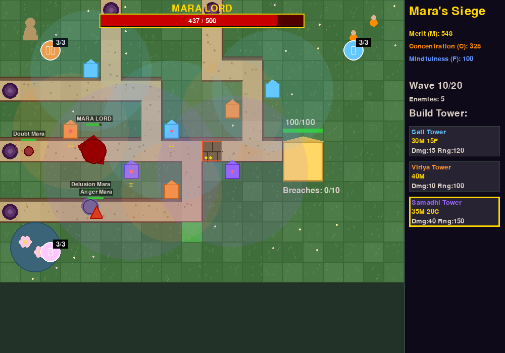

# Mara's Siege

A Buddhist-themed tower defense game made with Python and Pygame. You protect a meditating mind's temple from waves of Mara, the Buddhist figure of temptation and delusion.

**[Download and play it free on itch.io](https://smoald.itch.io/mara-siege)** (Windows, no install needed).



## What I built and why

I wanted a game that teaches Buddhist ideas through play instead of text. The towers are mental qualities: Sati (mindfulness), Viriya (energy) and Samadhi (concentration). The enemies are the hindrances that attack the mind, like Doubt, Craving and Pride.

An earlier version grew to 24 rounds of changes and stopped working. I went back to the last stable version and only added features one at a time, testing each one.

## Features

- **Two maps**
  - **Temple Garden:** sandy paths for Mara to walk, raised grass terraces for your towers and rocky cliff edges between them.
  - **Open Field:** the original map, where you can build anywhere and Mara walk straight at the temple.
- **3 towers:** each one is a Buddhist mental quality with its own cost, damage and range. Every tower can be upgraded twice.
- **Walls with 3 levels:**
  - Level 1 slows Mara.
  - Level 2 slows them twice as much and burns their health.
  - Level 3 stops them dead while it burns them.
- **3 abilities**, each with 3 uses per game:
  - The lotus pond (Metta) heals the temple.
  - The Buddha statue (Samadhi Wave) freezes every enemy for 5 seconds.
  - The monk (Karuna Strike) hits every enemy at once, in slow motion.
- **7 Mara enemies**, each with its own shape, speed and health.
  - Some sway from side to side.
  - Ignorance Mara wears armour.
  - Anger Mara stuns a tower as it passes.
  - Envy Mara steals your Merit if it reaches the temple.
- **Boss waves:** the Mara Lord arrives on wave 10 and the Mara Tyrant on the final wave. Each has a big health bar across the top of the screen.
- **3 resources** to manage:
  - Merit comes from defeating enemies.
  - Concentration comes from finishing waves.
  - Mindfulness comes from perfect waves where nothing reaches the temple.
- **4 difficulty levels:**
  - **Novice Monk:** 15 waves.
  - **Temple Guardian:** 20 waves.
  - **Dharma Defender:** 25 waves.
  - **Enlightenment Trial:** 30 waves.

  Harder levels have tougher, faster and more numerous Mara, less starting money and shorter breaks between waves.
- **Selling:** hover over a tower or wall and press S to get half its cost back.
- **Sound effects** generated in code: temple bells, a boss gong, singing-bowl tones and more. Press M to mute.

## How to play

| Key / mouse | What it does |
|---|---|
| Left click | Place a tower or wall, or select one you've built |
| Right click | Upgrade the selected tower or wall |
| 1 / 2 / 3 | Choose Sati, Viriya or Samadhi tower |
| W | Switch between building towers and walls |
| S | Sell the tower or wall under the mouse |
| Space | Start the next wave early |
| M | Mute or unmute sound |
| X | Clear what you're holding |
| Esc | Quit |

Click the lotus, the Buddha or the monk to use their abilities.

**To win:** survive every wave (15 to 30, depending on difficulty) with at least 1,000 Merit.
**You lose if:** the temple's health reaches 0, or 10 Mara break through.

## Tech stack

- **Python 3.12:** the language the game is written in.
- **Pygame:** draws the game and plays sound.
- **No image or sound files:** every shape and sound is made in code.

## How to run it locally

1. Install [Python 3.12](https://www.python.org/downloads/).
2. Download this project:
   ```bash
   git clone https://github.com/joshuablakemorekay/mara-siege.git
   cd mara-siege
   ```
3. Install what the game needs:
   ```bash
   pip install -r requirements.txt
   ```
4. Start the game:
   ```bash
   python main.py
   ```
5. On the menu, pick a difficulty and a map, then press **START GAME**.

## What I learned

- **Going back can be the fastest way forward.** Version 24 had piled-up features that broke the core game. Rebuilding from the stable original took much less time than untangling it.
- **Keep data separate from code.** The map paths, wall levels and boss waves all live in `config.py`, so I can rebalance the game without touching the logic.
- **Small, tested steps.** I tested each new feature with an automated run of the game before playing it. That made it easy to tell which change caused a problem.

---

*"Just as a solid rock is not shaken by the storm, even so the wise are not affected by praise or blame." (Dhammapada 81)*
